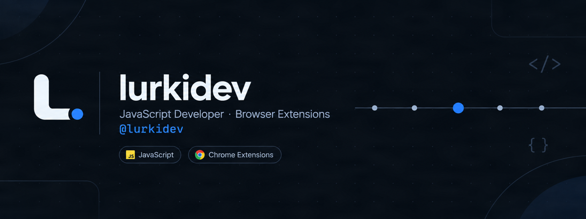

 

  

 

  <h2>Hey, I'm lurkidev.</h2>

  

    <strong>Independent Developer · JavaScript · Browser Extensions</strong>
  

  

    I build practical browser tools focused on improving everyday web experiences.
    Interested in clean functionality, thoughtful user experiences, and software that solves real problems.
  

  

    
    
    
  

---

## About

I'm an independent developer focused on **JavaScript and browser extension development**.

I enjoy building lightweight, practical software that improves existing experiences rather than adding unnecessary complexity.

My approach revolves around:

- **Functionality** — Building tools that solve actual problems.
- **Simplicity** — Keeping interfaces intuitive and implementations focused.
- **User experience** — Paying attention to the details that make software better to use.
- **Independence** — Exploring ideas and turning them into working projects.

## Tech Stack

  
  

## Featured Project

  

  <h3>
    <a href="https://github.com/lurkidev/instagram-reels-enhancer">Instagram Reels Enhancer</a>
  </h3>

  

    A browser extension designed to make watching Instagram Reels on desktop more comfortable.
  

**Highlights**

- Additional playback controls and configurable keyboard shortcuts.
- Reel navigation and playback preferences.
- Automatic skipping of detected sponsored content.
- Customizable settings and interface language.
- Built as a Manifest V3 browser extension.

  

---

  <h3>Building useful things, one project at a time.</h3>

  

    <a href="https://github.com/lurkidev">GitHub Profile</a>
    ·
    <a href="https://github.com/lurkidev?tab=repositories">Repositories</a>
  

  Designed and built by lurkidev.

